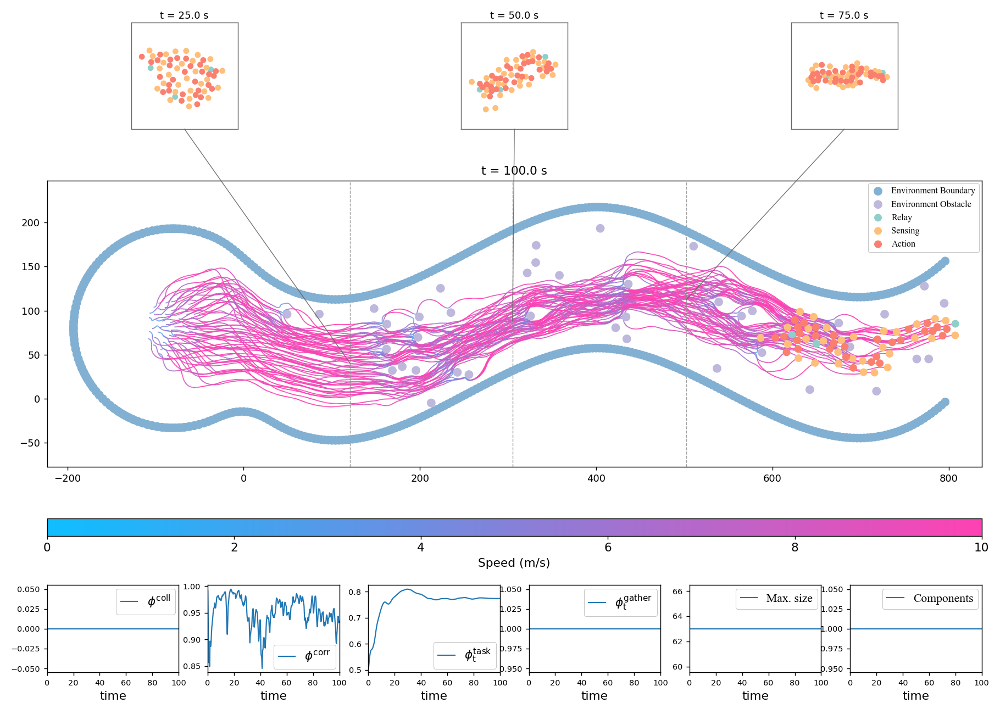
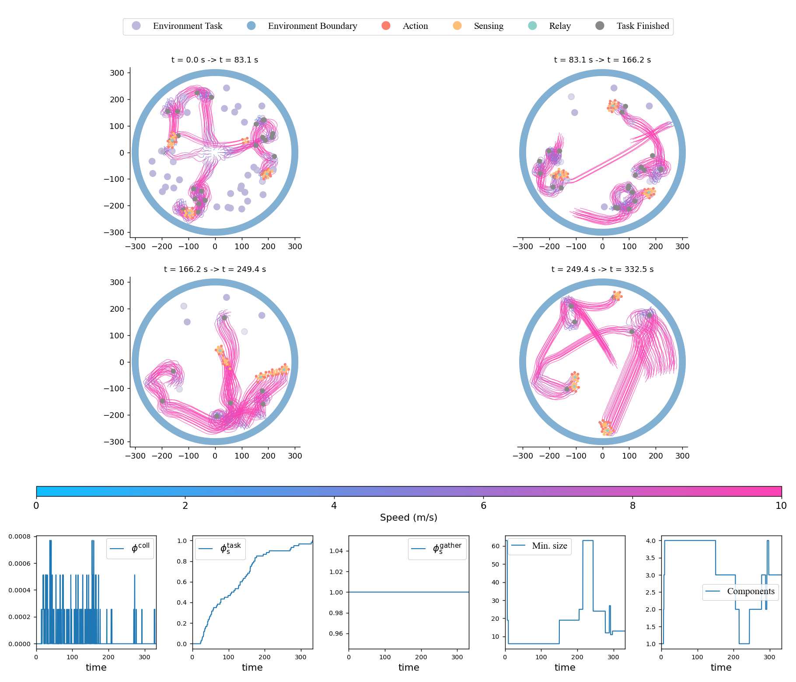

# MNDF

MNDF simulates heterogeneous robot swarms with a shared multilayer network model.
It includes two tasks, runnable example scenes, optimized controllers, and a
CMA-ES workflow for training new controllers.

- **Crossing** — guide a swarm through a curved, obstacle-filled channel.
- **Search-and-Rescue** — deploy a swarm to locate and service distributed tasks.



## Quick start

Use Python 3.10 and run the commands from the repository root.

```bash
git clone https://github.com/jodyyyyy/MNDF.git
cd MNDF
python -m pip install -r requirements.txt
python -m mndf simulate --config crossing_heter_1_rc60_ra10_rs30 --device cpu --t-max 2
```

This runs a two-second simulation with a bundled scene and prints the fitness
terms and objective as JSON. Use `--output ../fitness.json` to save them. For a
full run, remove `--t-max 2`. Use `--device cuda:0` with a CUDA-enabled PyTorch
installation for full runs and optimization.

## Visualize a simulation

Install the optional plotting dependencies, then render either bundled scene.
The commands below use the full 100-second Crossing and 400-second
Search-and-Rescue horizons. For a quick CPU preview, replace
`--device cuda:0` with `--device cpu --t-max 2`.

```bash
python -m pip install -r requirements-viz.txt
python -m mndf visualize --config crossing_heter_1_rc60_ra10_rs30 --device cuda:0 --output outputs/crossing
python -m mndf visualize --config searchandrescue_heter_1_rc60_ra10_rs30 --device cuda:0 --output outputs/search-and-rescue
```

Choose a new output directory for each run. The command also works on a
headless server and writes two files.

- `trajectories.png` shows robot paths colored by speed, intermediate swarm
  configurations for Crossing, and stage-by-stage paths and completed tasks
  for Search-and-Rescue. The figure includes time series for collision, task,
  gathering, and connectivity measures, plus correlation for Crossing.
- `fitness.json` contains the aggregated fitness terms and objective for the run.

The command reuses `visualize_state_trajectories` from the original Swarm
visualization code, included in [`mndf/Visualization_shared.py`](mndf/Visualization_shared.py).

Both `simulate` and `visualize` accept `--data-dir` for generated or custom scenes,
`--scene` for the scene index (default 1), and `--params` for a custom controller JSON.



Both previews use the bundled scene 1, the supplied `rc60_ra10_rs30`
parameters, and the full simulation horizon. The Search-and-Rescue figure
ends when the last task is completed.

## Model and parameter sets

At each integration step, MNDF builds communication and sensing links using
node types and interaction ranges, then derives logic and action links from
the network. Communication keeps at most 30 nearest eligible neighbors per
relay source and 10 per ordinary source. The simulator combines repulsion,
alignment, attraction, and self-drive to advance the robot states. Both tasks
use this implementation in [`mndf/dynamics.py`](mndf/dynamics.py).

Crossing uses a fixed self-drive direction `(1, 0)` and collision shaping
coefficient `0.00003`. Search-and-Rescue uses each robot’s current heading,
a collision radius of 3, and coefficient `0.001`. The supplied
Search-and-Rescue controllers come from the OriginalCollision / FixInitial
experiment. Both tasks use a 0.125-second integration step.

Each task ships 27 controllers with 57 optimized variables per controller.
The grid covers relay communication range `rc = 30, 60, 90`, action range
`ra = 5, 10, 15`, and sensing range `rs = 15, 30, 45`. Ordinary communication
range stays at 30. The configuration name encodes the three ranges.

## Generate scenes

Only one example scene per task is bundled. This command generates scenes
1–10 for the Crossing configuration used in the quick start.

```bash
python -m mndf generate --config crossing_heter_1_rc60_ra10_rs30 --samples 10 --seed 42 --output ../generated-training
```

Use `--examples --samples 1` to regenerate the two bundled configurations,
`--task crossing` or `--task searchandrescue` to select a task, or omit the
selection flags to generate scenes for all 54 configurations. Each scene uses
the base seed plus the scene index. A scene’s geometry is shared across
configurations, while its interaction ranges come from the selected configuration.
In Search-and-Rescue, robot initialization is fixed and task locations vary
across scenes. The default base seed 42 reproduces the bundled example inputs
to numerical tolerance.

The generator writes `generation.json` and two directories with the input
files expected by the simulator.

```text
NodeInitialLocationData/<config_name>_<scene_index>.json
TaskInfo/<config_name>_<scene_index>.json
```

The bundled examples show the JSON formats for both tasks. To use custom layer
relations, place a matching configuration under `Constraint/` alongside those
two directories. Otherwise the simulator uses the bundled relations.
The generator protects existing matching files unless you pass `--force`.

See `python -m mndf generate --help` for all options. To check scene
reproducibility, run `python -m unittest discover -s tests -v`.

## Optimize a controller

After generating scenes 1–10, start optimization with the matching
configuration.

```bash
python -m mndf optimize --config crossing_heter_1_rc60_ra10_rs30 --data-dir ../generated-training --device cuda:0 --output ../crossing-run
```

The single-device optimizer starts from seeded random parameters (seed 42,
initial sigma 0.5). It searches on scene 1 with 128 candidates per generation
for 100 generations. It then scores up to 256 distinct candidates across all
ten scenes and exports the controller with the highest mean objective. The
output directory must be new or empty and outside the repository. Pass the
resulting `../crossing-run/crossing_heter_1_rc60_ra10_rs30.json` to `simulate`
or `visualize` with `--params`.

For a pipeline check, add `--generations 1 --t-max 2` and use a separate output
directory. The check still requires ten input scenes.

## Repository layout

- [`mndf/`](mndf/) — simulation, scene generation, visualization, and optimization.
- [`examples/`](examples/) — input scenes for the two quick-start configurations.
- [`configs/`](configs/) — simulation and optimizer defaults for each task.
- [`optimized_params/`](optimized_params/) — 54 optimized controllers.
- [`Constraint/`](Constraint/) — allowed interactions between node types.
- [`Parameter/`](Parameter/) — search bounds for the controller variables.
- [`PROVENANCE.json`](PROVENANCE.json) — release manifest with original source
  paths and SHA-256 hashes for the controllers, relation files, and search
  bounds. The manifest supports research traceability and integrity checks.
