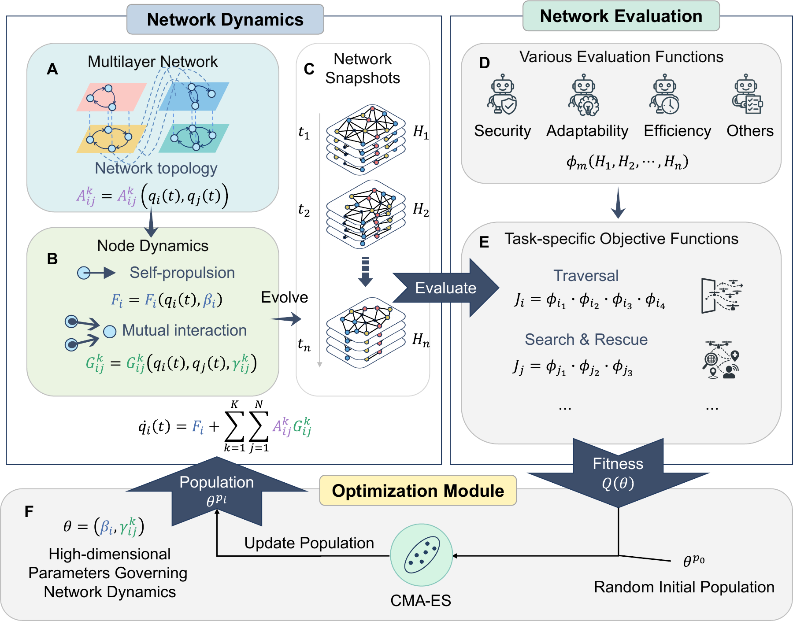

# Multilayer Network Dynamics Framework (MNDF)

## Framework overview

MNDF models a heterogeneous robot swarm as an interdependent multilayer network.
Each layer represents a distinct type of interaction, and dependencies between
layers encode task-level logic. Robots follow simple Reynolds-style local
interaction rules, whose strengths are optimized with CMA-ES for a given task.
This lets heterogeneous robots coordinate without centralized task allocation.

### System architecture

The multilayer topology determines which interactions are active at each time
step. Node dynamics combine self-propulsion with those interactions to generate
a sequence of network snapshots. Task-specific evaluation functions score the
resulting swarm behavior, and CMA-ES uses the scores to update the population
of candidate dynamics parameters.




## Quick start

This repository includes runnable example scenes, optimized controllers, and a
CMA-ES workflow for training new controllers.

Use Python 3.10 and run the commands from the repository root.

```bash
git clone https://github.com/jodyyyyy/MNDF.git
cd MNDF
python -m pip install -r requirements.txt
python -m mndf simulate --config crossing_heter_1_rc60_ra10_rs30 --device cpu --t-max 2
```

This runs a two-second simulation with a bundled scene and prints the fitness
terms and objective as JSON. Use `--output ../fitness.json` to save them. For a
full run, remove `--t-max 2`. Use `--device cuda:0` with a CUDA-enabled PyTorch
installation for full runs and optimization.

## Run a simulation

Run either bundled scene with its optimized parameters. The simulator loads
the matching controller from `optimized_params/` using the name passed to
`--config`.

```bash
python -m mndf simulate --config crossing_heter_1_rc60_ra10_rs30 --device cuda:0
python -m mndf simulate --config searchandrescue_heter_1_rc60_ra10_rs30 --device cuda:0
```

`simulate` prints the fitness terms and objective as JSON. The default
simulation time is 100 seconds for Crossing and 400 seconds for
Search-and-Rescue.

To generate a trajectory figure, use `visualize` in place of `simulate` and
set `--output` to a new directory. The directory receives `trajectories.png`
with robot paths and metric curves, along with `fitness.json`.

```bash
python -m mndf visualize --config crossing_heter_1_rc60_ra10_rs30 --device cuda:0 --output outputs/crossing
```

Both commands use scene 1 from `examples/` by default. To run a different
configuration or scene, supply the matching inputs with `--data-dir` and
select the scene index with `--scene`. Use `--params` to load a different
optimized controller JSON. For a short CPU run, replace `--device cuda:0`
with `--device cpu --t-max 2`.

## Generate scenes

Only one example scene per task is bundled. This command generates scenes
1–10 for the Crossing configuration used in the quick start.

```bash
python -m mndf generate --config crossing_heter_1_rc60_ra10_rs30 --samples 10 --seed 42 --output ../generated-training
```

Use `--examples --samples 1` to regenerate the two bundled configurations,
`--task crossing` or `--task searchandrescue` to select a task, or omit the
selection flags to generate scenes for all 54 configurations. Each scene uses
the base seed plus the scene index. A scene’s geometry is shared across
configurations, while its interaction ranges come from the selected configuration.
In Search-and-Rescue, robot initialization is fixed and task locations vary
across scenes. The default base seed 42 reproduces the bundled example inputs
to numerical tolerance.

The generator writes `generation.json` and two directories with the input
files expected by the simulator.

```text
NodeInitialLocationData/<config_name>_<scene_index>.json
TaskInfo/<config_name>_<scene_index>.json
```

The bundled examples show the JSON formats for both tasks. To use custom layer
relations, place a matching configuration under `Constraint/` alongside those
two directories. Otherwise the simulator uses the bundled relations.
The generator protects existing matching files unless you pass `--force`.

See `python -m mndf generate --help` for all options. To check scene
reproducibility, run `python -m unittest discover -s tests -v`.

## Optimize a controller

After generating scenes 1–10, start optimization with the matching
configuration.

```bash
python -m mndf optimize --config crossing_heter_1_rc60_ra10_rs30 --data-dir ../generated-training --device cuda:0 --output ../crossing-run
```

The single-device optimizer starts from seeded random parameters (seed 42,
initial sigma 0.5). It searches on scene 1 with 128 candidates per generation
for 100 generations. It then scores up to 256 distinct candidates across all
ten scenes and exports the controller with the highest mean objective. The
output directory must be new or empty and outside the repository. Pass the
resulting `../crossing-run/crossing_heter_1_rc60_ra10_rs30.json` to `simulate`
or `visualize` with `--params`.

For a pipeline check, add `--generations 1 --t-max 2` and use a separate output
directory. The check still requires ten input scenes.

## Repository layout

- [`mndf/`](mndf/) — simulation, scene generation, visualization, and optimization.
- [`examples/`](examples/) — input scenes for the two quick-start configurations.
- [`configs/`](configs/) — simulation and optimizer defaults for each task.
- [`optimized_params/`](optimized_params/) — 54 optimized controllers.
- [`Constraint/`](Constraint/) — allowed interactions between node types.
- [`Parameter/`](Parameter/) — search bounds for the controller variables.
